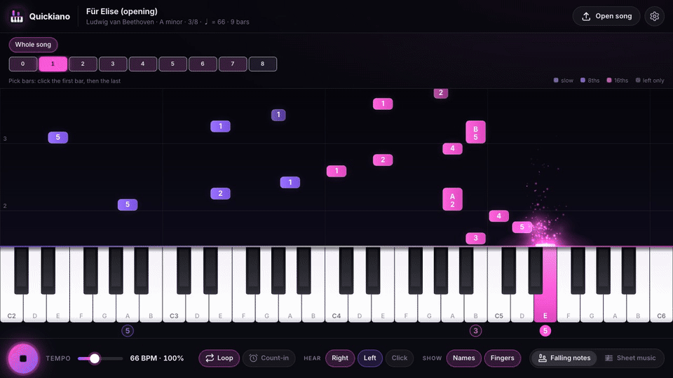
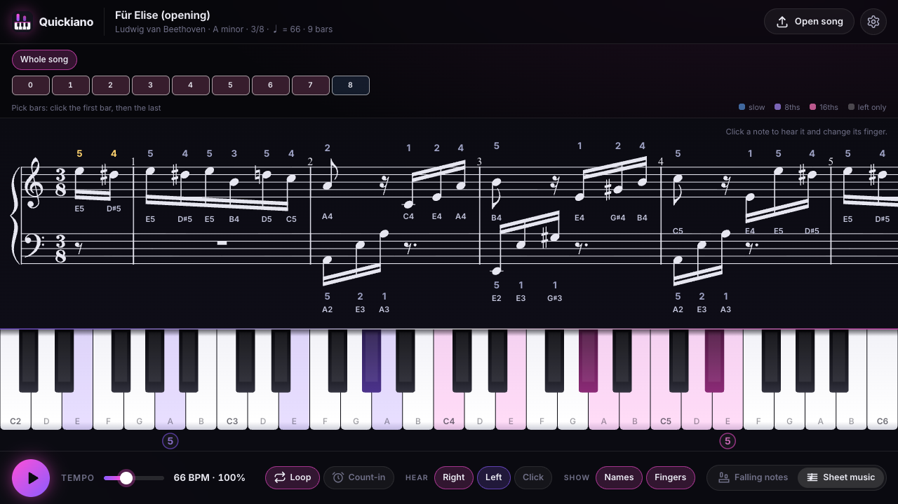

<div align="center">


# Quickiano

**Learn any piano song, fast.** Drop in sheet music and play along with glowing falling notes or the real score. Slow it down, loop the hard bars, see every finger.

[**Open Quickiano**](https://quickiano.pages.dev/) · free · no sign-up · runs in your browser

[](https://github.com/adrijus-lazdauskas/quickiano/actions/workflows/ci.yml)
[](https://quickiano.pages.dev/)
[](LICENSE)



</div>

## Why

YouTube piano tutorials are great until you need bar 23 at half speed, with the left hand only, ten times in a row. Quickiano turns any song file into that tutorial, and you are in control of it:

- 🎹 **Falling notes** like the videos you know, with neon glow and sparks, in sync with a real grand piano sound.
- 🎼 **Sheet music** for the same bars, so you learn to read the notes while you play.
- ✋ **Finger numbers** on every note and right under the keys, suggested automatically for both hands. Fingerings written in the score are kept, and you can change any finger with one key press.
- 🐢 **Any tempo** from a crawl to full speed, changeable while it plays.
- 🔁 **Loop any bars**: pick a part with one click or choose your own first and last bar.
- 👂 **Hands separately**: mute the right or the left hand and play that part yourself.
- ⏱️ **Count-in and click** so you start on the beat.
- 🔤 **Note names** in the system you learned: C D E F G A **B**, C D E F G A **H** (German), or **Do Re Mi**.
- 🎨 **Your colours** for each hand, five presets or any colour you like.
- 📄 **PDF to song (beta)**: drop a printed sheet music PDF and Quickiano's free converter reads the notes for you.
- 🔒 **Private by design**: songs are read and stored in your own browser, with no account and no tracking. Only a PDF you choose to convert is sent to the converter, which deletes it right after.

## How it works

1. **Open** [Quickiano](https://quickiano.pages.dev/) and drop a MusicXML or MIDI file onto the page (or try one of the demos).
2. **Pick** the bars you want to practise and set a comfortable tempo.
3. **Play** along. Speed up a little every time it feels easy.

Quickiano remembers your recent songs, the bars you were working on and every finger you changed.



## Where do I get a song file?

Quickiano reads **MusicXML** (`.musicxml`, `.xml`, compressed `.mxl`), **MIDI** (`.mid`) and, in beta, **PDF**. MusicXML is the open format every notation program exports; it gives you sheet music and falling notes. MIDI gives you falling notes.

- **From a PDF:** drop it into Quickiano and click _Convert_ (beta). The PDF goes to Quickiano's free converter ([Audiveris](https://github.com/Audiveris/audiveris) on a Hugging Face Space, code in [`server/`](server/)), which reads the notes and deletes the file right after. It usually takes one to four minutes; clean printed scores work best, so compare a few bars with your PDF. Prefer to do it yourself: [MuseScore Studio](https://musescore.org) (_File → Import PDF_) or [Audiveris](https://audiveris.github.io/audiveris/) offline, then export MusicXML.
- **Download:** many scores on [MuseScore.com](https://musescore.com) and public domain pieces on [IMSLP](https://imslp.org) come as MusicXML or MIDI.
- **Write it yourself:** any notation app (MuseScore, Dorico, Sibelius, Finale, Flat.io, Noteflight) can export MusicXML.

Please only use files you are allowed to use. Quickiano ships nothing but public domain demos.

## Keyboard shortcuts

| Key                       | Does                                     |
| ------------------------- | ---------------------------------------- |
| <kbd>Space</kbd>          | Play / stop                              |
| <kbd>↑</kbd> <kbd>↓</kbd> | Tempo up / down                          |
| Click a note              | Hear it and select it (sheet music view) |
| <kbd>1</kbd>–<kbd>5</kbd> | Set the finger for the selected note     |
| <kbd>0</kbd>              | Back to the suggested finger             |
| <kbd>←</kbd> <kbd>→</kbd> | Previous / next note in the same hand    |
| <kbd>Esc</kbd>            | Deselect, close settings                 |

## Run it locally

You need [Node.js](https://nodejs.org) 22 or newer.

```bash
git clone https://github.com/adrijus-lazdauskas/quickiano.git
cd quickiano
npm install
npm run dev
```

Then open the address Vite prints (usually http://localhost:5173).

The live site is built by Cloudflare Pages from `main`. To host it somewhere else, set `BASE_PATH` (the folder it is served from, default `/`) and `SITE_URL` (its public address, used for link previews) when building, e.g. `BASE_PATH=/quickiano/ SITE_URL=https://you.github.io/quickiano/ npm run build`.

| Command          | What it does                                                                            |
| ---------------- | --------------------------------------------------------------------------------------- |
| `npm run dev`    | Development server with hot reload                                                      |
| `npm test`       | Unit tests (parser, fingering, note names, MIDI, …)                                     |
| `npm run lint`   | ESLint and Prettier check                                                               |
| `npm run build`  | Production build into `dist/`                                                           |
| `npm run demos`  | Regenerate the demo MusicXML files                                                      |
| `npm run record` | Re-record the README GIF and screenshots (dev server must run, needs Chrome and ffmpeg) |

## How it is built

Plain TypeScript and Vite, no UI framework. The interesting parts:

- [`src/core/musicxml.ts`](src/core/musicxml.ts) reads MusicXML into one timeline of notes in quarter notes, with ties, grace notes, pickups and 8va lines. [`src/core/midi.ts`](src/core/midi.ts) does the same for MIDI.
- [`src/core/fingering.ts`](src/core/fingering.ts) suggests fingers with dynamic programming over a finger-span comfort table, for each hand. Fingers from the score and your own changes steer the notes around them.
- [`src/player/transport.ts`](src/player/transport.ts) schedules notes ahead on the Web Audio clock, so timing stays tight even when the screen is busy.
- [`src/views/falling.ts`](src/views/falling.ts) and [`src/views/effects.ts`](src/views/effects.ts) draw the falling notes and particles on a canvas; [`src/views/sheet.ts`](src/views/sheet.ts) renders the score with OpenSheetMusicDisplay and adds its own finger and note-name layer.
- [`server/`](server/) is the optional PDF converter: a small FastAPI service around Audiveris that runs conversions as jobs, deployed to a free Hugging Face Space by the `Converter` workflow.

## Contributing

Ideas, bug reports and pull requests are welcome. If a file doesn't load or looks wrong, please open an issue and attach the file if you can (only if you are allowed to share it). Commits follow [Conventional Commits](https://www.conventionalcommits.org), and `npm run lint && npm test` should pass before a pull request.

## Credits

- Piano sound: [Salamander Grand Piano](https://archive.org/details/SalamanderGrandPianoV3) by Alexander Holm, [CC BY 3.0](https://creativecommons.org/licenses/by/3.0/), via [Tone.js audio](https://github.com/Tonejs/audio)
- Sheet music rendering: [OpenSheetMusicDisplay](https://opensheetmusicdisplay.org) (BSD-3-Clause)
- MIDI parsing: [@tonejs/midi](https://github.com/Tonejs/Midi) (MIT)
- PDF recognition: [Audiveris](https://github.com/Audiveris/audiveris) (AGPL-3.0, runs unmodified in the converter) with [Tesseract](https://github.com/tesseract-ocr/tessdata) OCR data (Apache-2.0)
- Font: [Inter](https://rsms.me/inter/) (OFL)

## License

[MIT](LICENSE) © Adrijus Lazdauskas
